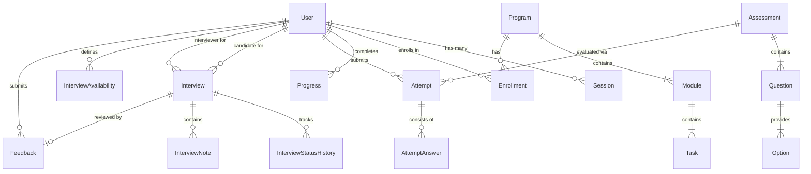

# Interveasy — System Architecture Documentation

> **Version:** 1.0.0  
> **Target Framework:** NestJS 11 + TypeScript 5  
> **Database:** PostgreSQL 15+ via Prisma ORM 7 (`@prisma/adapter-pg`)  
> **Security Baseline:** OWASP ASVS v4.0 Level 2 compliant

---

## 1. Architectural Philosophy & Overview

Interveasy is designed as a **Modular Monolith** engineered for high developer productivity, clear domain separation, testability, and enterprise-grade resilience. The application cleanly decouples business rules from HTTP transport details and persistence layers.

```
+-------------------------------------------------------------------------+
|                               HTTP Client                               |
+-------------------------------------------------------------------------+
                                     |
                                     v
+-------------------------------------------------------------------------+
|                         NestJS Pipeline Layer                           |
|  Global Prefix (/api) -> CORS -> Cookies -> ThrottlerGuard -> CSRF Guard|
+-------------------------------------------------------------------------+
                                     |
                                     v
+-------------------------------------------------------------------------+
|                            Routing & Guards                             |
|        JwtAuthGuard (Passport JWT)  -->  RolesGuard (@Roles)            |
+-------------------------------------------------------------------------+
                                     |
                                     v
+-------------------------------------------------------------------------+
|                           Pipes & Validation                            |
|             ValidationPipe (whitelist, forbidNonWhitelisted)            |
+-------------------------------------------------------------------------+
                                     |
                                     v
+-------------------------------------------------------------------------+
|                           Controllers Layer                             |
|          Auth · Users · Programs · Assessments · Interviews · Leads      |
+-------------------------------------------------------------------------+
                                     |
                                     v
+-------------------------------------------------------------------------+
|                         Business Services Layer                         |
|     State Machines · Scoring Engine · Conflict Detector · Aggregators    |
+-------------------------------------------------------------------------+
                                     |
                                     v
+-------------------------------------------------------------------------+
|                            Persistence Layer                            |
|      PrismaClient Singleton  <-->  @prisma/adapter-pg  <-->  pg.Pool    |
+-------------------------------------------------------------------------+
                                     |
                                     v
+-------------------------------------------------------------------------+
|                        PostgreSQL 15+ Relational DB                     |
+-------------------------------------------------------------------------+
```

---

## 2. Request-Response Lifecycle Pipeline

Every inbound HTTP request traverses an orchestrated sequence of layers before touching domain logic:

```
Request Inbound
      │
      ▼
1. Express Middlewares
   ├── cookie-parser: Parses incoming HTTP-only cookies
   └── CORS: Validates Origin header against whitelist
      │
      ▼
2. Global Guards
   ├── ThrottlerGuard: IP-based rate limiting (100 req / 60s)
   └── CsrfGuard: Double-Submit Cookie validation for state-changing calls (POST/PUT/PATCH/DELETE)
      │
      ▼
3. Route Guards
   ├── JwtAuthGuard: Verifies JWT signature, exp, and extracts sub/role/sid
   └── RolesGuard: Enforces RBAC permissions based on Reflector metadata
      │
      ▼
4. Interceptors (Global & Route)
   └── Logging & Serialization interceptors
      │
      ▼
5. Validation Pipes
   └── ValidationPipe: Transforms incoming payloads into validated DTO instances
      │
      ▼
6. Controller Handler
   └── Extracts params/DTOs/CurrentUser, delegates execution to Service
      │
      ▼
7. Service & Domain Logic
   └── Executes business logic, transactions, and calls PrismaService
      │
      ▼
8. Prisma ORM / PostgreSQL
   └── Executes SQL query or transaction pool
      │
      ▼
Response Outbound (or GlobalHttpExceptionFilter on error)
```

---

## 3. Modular Architecture Breakdown

The codebase is organized into bounded contexts, each mapping to a dedicated NestJS module:

| Domain Module | Primary Responsibilities | Key Design Patterns |
|---|---|---|
| `AuthModule` | Authentication, credential checks, JWT issuance, session lifecycle, token rotation | Strategy Pattern (Passport), Cryptographic Hashing |
| `UsersModule` | User directory, profile updates, role assignment, safe projection masks | Safe Select Projection (`PUBLIC_USER_SELECT`) |
| `ProgramsModule` | Multi-track curriculum (AWS, Azure, GCP), hierarchical course tree | Composite Pattern (Program -> Modules -> Tasks) |
| `EnrollmentsModule` | User course registration, enrollment status management | Unique Constraint Invariants |
| `ProgressModule` | Task completion tracking, real-time completion percentage aggregation | Idempotent Upsert / Transaction |
| `AssessmentsModule` | Question bank management, randomized test assembly, attempt tracking | Aggregate Root Pattern |
| `ScoringModule` | Pure deterministic grading engine, score rounding, skill tier mapping | Pure Functional Engine, Strategy Pattern |
| `InterviewsModule` | Slot booking, timezone conversions, scheduling conflict engine, state transitions | Finite State Machine (FSM), Interval Overlap Math |
| `FeedbackModule` | Post-interview evaluations, 1-5 rubric scores, SQL metric aggregations | CQRS-style Aggregations (`AVG`, `MIN`, `MAX`) |
| `LeadsModule` | Enterprise demo capture, domain normalization, deduplication, conversion CRM | Idempotency Engine, Normalization Filters |

---

## 4. Database Invariants & Entity Relationships

The PostgreSQL relational model guarantees data integrity at the database level:



### Critical DB Constraints
- **Session Security**: `Session.hashedRefreshToken` is indexed and uniquely tied to `Session.id`.
- **Enrollment Uniqueness**: Composite unique index `@@unique([userId, programId])` prevents double enrollment.
- **Progress Idempotency**: Composite unique index `@@unique([userId, taskId])` prevents duplicate task completions.
- **Interview Conflict Guard**: Composite index `@@index([interviewerId, startAt, endAt])` accelerates interval overlap scans.
- **Lead Deduplication**: `Lead.email` unique constraint + normalized domain tracking prevents sales spam.

---

## 5. Security & Cryptographic Architecture

### 5.1 Authentication & Token Lifecycle
1. **Password Hashing**: `bcrypt` with `12 salt rounds`. A precomputed dummy hash (`DUMMY_PASSWORD_HASH`) is compared when an email does not exist to guarantee constant-time execution against user enumeration timing attacks.
2. **Access Token**: Short-lived (15 minutes), signed using HMAC-SHA256 (`HS256`). Carries `sub` (User UUID), `email`, `role`, `sid` (Session UUID), and a cryptographic `jti` (JWT ID).
3. **Refresh Token**: High-entropy opaque secret (`<sessionId>.<32-byte-base64url-random-secret>`). Only its SHA-256 hash is persisted in the database.
4. **Refresh Token Rotation (RTR)**: Every call to `/auth/refresh` issues a fresh refresh token and rotates the stored hash. If an already-consumed token is presented (token replay), the entire session is revoked immediately.
5. **CSRF Protection**: State-changing requests (`POST`, `PUT`, `PATCH`, `DELETE`) require matching CSRF header and cookie tokens (Double-Submit Cookie pattern).

---

## 6. Core Algorithmic Engines

### 6.1 Pure Deterministic Scoring Engine (`ScoringService`)
The scoring calculation is implemented as a pure, side-effect-free mathematical function:
- **Single-Choice**: Exact match between candidate's submitted option ID and the question's correct option ID.
- **Multiple-Choice**: Set-theoretic equivalence:
  $$\text{IsCorrect} = (S_{\text{submitted}} = S_{\text{correct}}) \land (|S_{\text{submitted}}| = |S_{\text{correct}}|)$$
  Partial credit is strictly zero to prevent guess-bruteforcing.
- **Overall Score**:
  $$\text{Score} = \text{round}\left(\frac{\sum \text{EarnedPoints}}{\sum \text{TotalAvailablePoints}} \times 100, 2\right)$$
- **Skill Level Mapping**:
  - `0 - 49.99%`  $\rightarrow$ `BEGINNER`
  - `50 - 69.99%` $\rightarrow$ `INTERMEDIATE`
  - `70 - 84.99%` $\rightarrow$ `ADVANCED`
  - `85 - 100%`   $\rightarrow$ `EXPERT`

### 6.2 Conflict Detection Engine (`InterviewsService`)
Two intervals $[A_{\text{start}}, A_{\text{end}}]$ and $[B_{\text{start}}, B_{\text{end}}]$ overlap if and only if:
$$A_{\text{start}} < B_{\text{end}} \quad \text{AND} \quad A_{\text{end}} > B_{\text{start}}$$

This test is executed inside a PostgreSQL database transaction across all active statuses (`PENDING`, `CONFIRMED`) checking both candidate and interviewer IDs.

### 6.3 Interview State Machine
Permitted transitions are strictly regulated:
```
           ┌──────────────┐
           │   PENDING    │
           └──────┬───────┘
                  │
        ┌─────────┴─────────┐
        ▼                   ▼
┌───────────────┐   ┌───────────────┐
│   CONFIRMED   │   │   CANCELLED   │
└───────┬───────┘   └───────────────┘
        │
   ┌────┴────┐
   ▼         ▼
┌──────────┐ ┌──────────┐
│COMPLETED │ │CANCELLED │
└──────────┘ └──────────┘
```

---

## 7. Performance & Query Optimization

1. **Selective Projections**: Never return raw `prisma.user.findMany()`. All queries use explicit `select` objects omitting sensitive fields like `password`.
2. **SQL Aggregation**: Module and track progress metrics compute completion percentages using SQL grouping rather than loading full task trees into memory.
3. **Database Driver Optimization**: Integrated Prisma 7 with native `@prisma/adapter-pg` driver adapter using connection pooling for low overhead and horizontal scalability.
