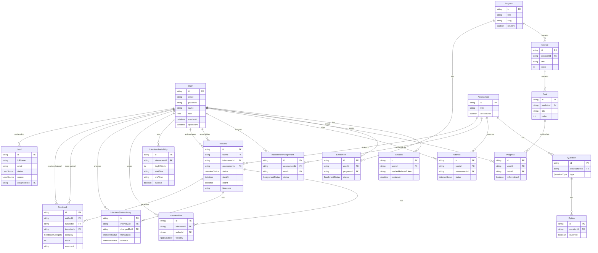
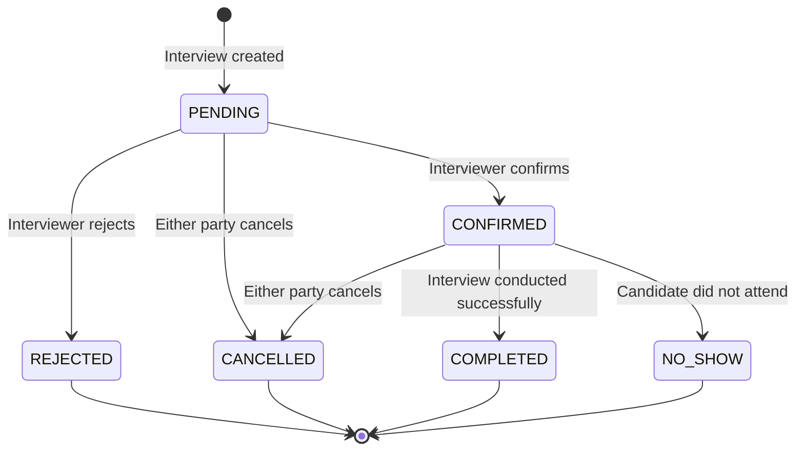
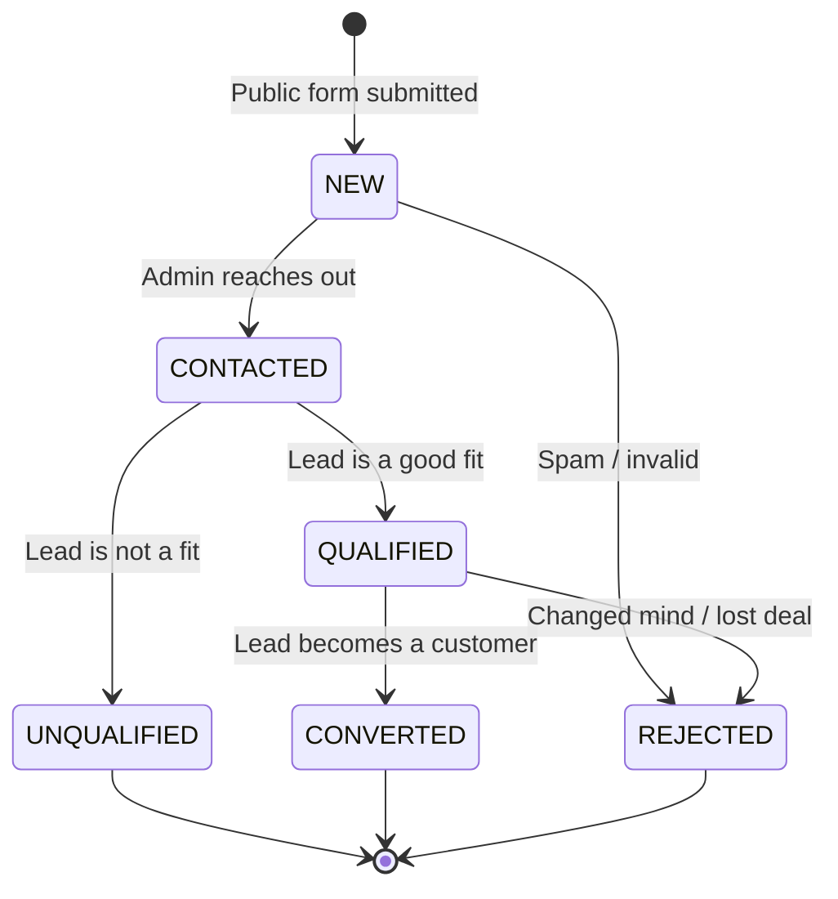

# Interveasy — System Design Document

> **Version:** 1.0  
> **Date:** 2026-11-13  
> **Stack:** NestJS · PostgreSQL · Prisma ORM (PrismaPg adapter) · JWT Auth

---

## 1. Actors

| Actor | Description | Role in DB |
|-------|-------------|-----------|
| **Public** | Unauthenticated visitors; may submit a demo/contact request (Lead) | — |
| **Candidate** | Authenticated user (role `USER`) who books interviews and receives feedback | `Role.USER` |
| **Interviewer** | Authenticated user (role `USER`) who conducts interviews, sets availability, writes notes | `Role.USER` |
| **Admin** | Authenticated user (role `ADMIN`); manages users, leads, programs, assessments, sees all data | `Role.ADMIN` |

> **Note:** Candidate and Interviewer are the same DB row (`User`); the distinction is contextual (the `userId` vs `interviewerId` FK on `Interview`).

---

## 2. Entity-Relationship Diagram

---

## 3. Business Rules

### 3.1 Interview Module

| Rule | Detail |
|------|--------|
| **No self-interview** | `candidateId ≠ interviewerId` (enforced in service) |
| **Past bookings blocked** | `startAt` must be in the future |
| **Chronological** | `startAt < endAt` |
| **Availability check** | Candidate must book within an active `InterviewAvailability` slot for the interviewer |
| **No double-booking** | Overlapping PENDING/CONFIRMED interviews for either party cause 409 Conflict |
| **Status transitions** | Only allowed transitions (see §6 diagram); enforced by `canTransition()` utility |
| **Timezone required** | IANA timezone string must be provided; validated by `assertValidIanaTimezone()` |
| **Note visibility** | `PRIVATE` notes are only visible to their author; `SHARED` notes visible to both candidate and interviewer |
| **Access control** | Only candidate, interviewer, or Admin can view an interview |

**Allowed status transitions:**

| From | To (allowed) |
|------|-------------|
| PENDING | CONFIRMED, REJECTED, CANCELLED |
| CONFIRMED | CANCELLED, COMPLETED, NO_SHOW |
| REJECTED | — (terminal) |
| CANCELLED | — (terminal) |
| COMPLETED | — (terminal) |
| NO_SHOW | — (terminal) |

### 3.2 Feedback Module

| Rule | Detail |
|------|--------|
| **One per category per interview** | `@@unique([authorId, interviewId, category])` — prevents duplicate ratings |
| **Score range** | 1–5 (enforced at DTO level via `@Min(1) @Max(5)`) |
| **Author ≠ Subject** | The reviewer cannot rate themselves |
| **Interview must be COMPLETED** | Feedback may only be submitted on a COMPLETED interview |
| **Who can submit** | Interviewer rates the candidate; Admin may submit on behalf of reviewers |
| **Who can read** | Author sees their own; Subject sees feedback about themselves; Admin sees all |
| **Who can delete** | Author (within grace period) or Admin |

### 3.3 Leads Module

| Rule | Detail |
|------|--------|
| **Public submission** | No auth required to POST `/leads` |
| **Duplicate detection** | Email + status=NEW uniqueness check prevents flooding (soft rule; not a DB constraint) |
| **Status progression** | NEW → CONTACTED → QUALIFIED/UNQUALIFIED → CONVERTED/REJECTED (see §6 diagram) |
| **Assignment** | Admins assign leads to other users (typically sales staff); `assignedToId` is nullable |
| **Admin notes** | Only Admins can write `adminNotes`; not exposed to public |
| **Analytics** | Admins can query aggregate counts, conversion rates, by-source breakdowns |

---

## 4. API Endpoints

### Auth — `/auth`

| Method | Path | Auth | Description |
|--------|------|------|-------------|
| POST | `/auth/register` | Public (throttled 5/min) | Register new user |
| POST | `/auth/login` | Public (throttled 5/min) | Login, returns JWT + sets refresh cookie |
| POST | `/auth/refresh` | CSRF cookie | Refresh access token |
| POST | `/auth/logout` | CSRF cookie | Revoke refresh token, clear cookies |
| GET | `/auth/sessions` | JWT | List active sessions |
| DELETE | `/auth/sessions/:id` | JWT | Revoke a specific session |

### Users — `/users`

| Method | Path | Auth | Description |
|--------|------|------|-------------|
| GET | `/users` | JWT + Admin | List all users |
| GET | `/users/me` | JWT | Get own profile |
| PATCH | `/users/me` | JWT | Update own profile |
| GET | `/users/:id` | JWT | Get user (self or Admin) |
| PUT | `/users/:id/role` | JWT + Admin | Change user role |

### Programs — `/programs`

| Method | Path | Auth | Description |
|--------|------|------|-------------|
| POST | `/programs` | JWT + Admin | Create program |
| GET | `/programs` | JWT | List active programs |
| GET | `/programs/:id` | JWT | Get program detail |
| PATCH | `/programs/:id` | JWT + Admin | Update program |
| DELETE | `/programs/:id` | JWT + Admin | Delete program |

### Modules — `/programs/:programId/modules`

| Method | Path | Auth | Description |
|--------|------|------|-------------|
| POST | `/programs/:id/modules` | JWT + Admin | Add module |
| GET | `/programs/:id/modules` | JWT | List modules |
| PATCH | `/programs/:id/modules/:moduleId` | JWT + Admin | Update module |
| DELETE | `/programs/:id/modules/:moduleId` | JWT + Admin | Delete module |

### Tasks — `/modules/:moduleId/tasks`

| Method | Path | Auth | Description |
|--------|------|------|-------------|
| POST | `/modules/:id/tasks` | JWT + Admin | Add task |
| GET | `/modules/:id/tasks` | JWT | List tasks |
| PATCH | `/modules/:id/tasks/:taskId` | JWT + Admin | Update task |
| DELETE | `/modules/:id/tasks/:taskId` | JWT + Admin | Delete task |

### Enrollments — `/enrollments`

| Method | Path | Auth | Description |
|--------|------|------|-------------|
| POST | `/enrollments` | JWT | Enroll in program |
| GET | `/users/me/enrollments` | JWT | List my enrollments |
| PATCH | `/enrollments/:id/status` | JWT + Admin | Update enrollment status |

### Progress — `/progress`

| Method | Path | Auth | Description |
|--------|------|------|-------------|
| POST | `/progress` | JWT | Mark task complete |
| GET | `/users/me/progress` | JWT | Get my progress |

### Assessments — `/assessments`

| Method | Path | Auth | Description |
|--------|------|------|-------------|
| POST | `/assessments` | JWT + Admin | Create assessment |
| GET | `/assessments` | JWT | List published assessments |
| GET | `/assessments/:id` | JWT | Get assessment |
| PATCH | `/assessments/:id` | JWT + Admin | Update assessment |
| POST | `/assessments/:id/questions` | JWT + Admin | Add question |
| POST | `/assessments/:id/assign` | JWT + Admin | Assign to user |

### Attempts — `/attempts`

| Method | Path | Auth | Description |
|--------|------|------|-------------|
| POST | `/attempts` | JWT | Start attempt |
| GET | `/attempts/:id` | JWT | Get attempt detail |
| POST | `/attempts/:id/submit` | JWT | Submit attempt |
| POST | `/attempts/:id/answers` | JWT | Save answer |

### Interviews — `/interviews`

| Method | Path | Auth | Description |
|--------|------|------|-------------|
| POST | `/interviews` | JWT | Create interview (candidate books) |
| GET | `/users/me/interviews` | JWT | List my interviews (paginated, filterable) |
| GET | `/interviews/:id` | JWT | Get interview detail + notes + history |
| PATCH | `/interviews/:id/status` | JWT | Update interview status |
| POST | `/interviews/:id/notes` | JWT | Add note to interview |

### Interview Availability — `/interviewers`

| Method | Path | Auth | Description |
|--------|------|------|-------------|
| GET | `/interviewers/:id/availability` | JWT | Get available slots for an interviewer |
| POST | `/interviewers/me/availability` | JWT | Add availability window |
| PATCH | `/interviewers/me/availability/:id` | JWT | Update availability window |
| DELETE | `/interviewers/me/availability/:id` | JWT | Remove availability window |

### Feedback — `/feedback` *(new)*

| Method | Path | Auth | Description |
|--------|------|------|-------------|
| POST | `/feedback` | JWT | Submit feedback for an interview |
| GET | `/feedback` | JWT + Admin | List all feedback (paginated) |
| GET | `/feedback/:id` | JWT | Get feedback by ID |
| PATCH | `/feedback/:id` | JWT | Update own feedback |
| DELETE | `/feedback/:id` | JWT | Delete own feedback (or Admin) |
| GET | `/users/me/feedback/given` | JWT | Feedback I submitted |
| GET | `/users/me/feedback/received` | JWT | Feedback about me |
| GET | `/users/:id/performance` | JWT + Admin | Aggregated scores by category for a user |
| GET | `/feedback/analytics` | JWT + Admin | Overall analytics (avg scores, distribution) |

### Leads — `/leads` *(new)*

| Method | Path | Auth | Description |
|--------|------|------|-------------|
| POST | `/leads` | **Public** | Submit demo / contact request |
| GET | `/leads` | JWT + Admin | List all leads (paginated, filterable) |
| GET | `/leads/:id` | JWT + Admin | Get lead detail |
| PATCH | `/leads/:id` | JWT + Admin | Update lead (status, notes, assignment) |
| DELETE | `/leads/:id` | JWT + Admin | Delete lead |
| GET | `/leads/analytics` | JWT + Admin | Counts by status, source, conversion rate |

---

## 5. Status Transition Diagrams

### 5.1 Interview Lifecycle

### 5.2 Lead Lifecycle

---

## 6. Edge Cases

### Interviews
| Scenario | Handling |
|----------|----------|
| Booking overlaps with another interview | 409 Conflict (enforced inside `$transaction` with select-for-update semantics) |
| Interviewer has no availability set | 400 Bad Request — "Interviewer is not available during the requested time" |
| Availability in different timezone | `startAt`/`endAt` stored as UTC; availability windows converted via IANA timezone |
| Status transition not allowed | 400 Bad Request — "Transition not allowed" |
| Candidate books themselves | 400 Bad Request — "Candidate and interviewer must be different users" |
| Assessment linked to interview is deleted | Assessment FK uses `onDelete: SetNull` — interview persists without assessment |

### Feedback
| Scenario | Handling |
|----------|----------|
| Duplicate feedback (same author + interview + category) | 409 Conflict (unique constraint violation) |
| Feedback on non-COMPLETED interview | 400 Bad Request |
| Author tries to rate themselves | 400 Bad Request — "Cannot submit feedback about yourself" |
| Score out of range | 400 Bad Request (DTO validation) |
| Interview deleted while feedback exists | Cascade delete removes all related feedback |

### Leads
| Scenario | Handling |
|----------|----------|
| Same email submits twice with status NEW | Service-level duplicate check → 409 Conflict |
| `assignedTo` user is deleted | FK uses `onDelete: SetNull` — lead remains unassigned |
| Public user submits with XSS payload | NestJS validation pipe + `@IsString()` guards prevent injection |
| Invalid lead status transition | Service validates allowed transitions and returns 400 |

---

## 7. Security & Ownership Rules

### Authentication
- All private endpoints require `JwtAuthGuard` (Bearer token in `Authorization` header).
- Access tokens are short-lived (configurable). Refresh tokens are stored hashed (`Session.hashedRefreshToken`).
- CSRF protection on all state-mutating cookie operations (`CsrfGuard`).
- Login and register endpoints are throttled (5 req/min per IP).

### Ownership & Authorization

| Resource | Owner check | Admin override |
|----------|-------------|----------------|
| Interview (view) | `userId` or `interviewerId` | ✅ |
| Interview (status change) | `userId` or `interviewerId` (with transition rules) | ✅ |
| Interview note (write) | Must be participant | ✅ |
| Interview note (read PRIVATE) | Only note author | ✅ |
| Feedback (write) | Must be `authorId` and participant in interview | ✅ |
| Feedback (read own given) | `authorId === userId` | ✅ |
| Feedback (read own received) | `subjectId === userId` | ✅ |
| Lead (submit) | Anyone (public) | — |
| Lead (read/update/delete) | Admin only | ✅ |
| User profile (read/edit) | Self only (or Admin) | ✅ |
| User role change | Admin only | ✅ |

### Data Integrity
- Cascade deletes prevent orphaned records: deleting a `User` removes their sessions, enrollments, progress, interviews, feedback, notes.
- SetNull on `Lead.assignedToId` preserves leads when a user is removed.
- SetNull on `Interview.assessmentId` preserves interviews when an assessment is removed.
- Unique constraints prevent duplicate enrollments, duplicate feedback-per-category, and duplicate assessment assignments.

### Input Validation
- All DTOs use `class-validator` decorators; `ValidationPipe` is global with `whitelist: true, forbidNonWhitelisted: true`.
- UUIDs are validated via `ParseUUIDPipe` on all `:id` path params.
- Enum values validated with `@IsEnum()`.
- Text lengths bounded with `@MaxLength()`.

---

## 8. Database Schema Summary (New Additions)

### New Enums
| Enum | Values |
|------|--------|
| `FeedbackCategory` | TECHNICAL, COMMUNICATION, PROBLEM_SOLVING, BEHAVIORAL, OVERALL |
| `LeadStatus` | NEW, CONTACTED, QUALIFIED, UNQUALIFIED, CONVERTED, REJECTED |
| `LeadSource` | WEBSITE, REFERRAL, SOCIAL_MEDIA, EMAIL_CAMPAIGN, DIRECT, OTHER |

### New Models
| Model | Key Fields | Relations |
|-------|-----------|-----------|
| `Feedback` | `authorId`, `subjectId`, `interviewId`, `category`, `score` (1-5) | `author→User`, `subject→User`, `interview→Interview` |
| `Lead` | `fullName`, `email`, `status`, `source`, `assignedToId` | `assignedTo→User` |

### New Fields on Existing Models
| Model | Field Added |
|-------|-------------|
| `User` | `feedbackGiven Feedback[] @relation("FeedbackAuthor")` |
| `User` | `feedbackReceived Feedback[] @relation("FeedbackSubject")` |
| `User` | `assignedLeads Lead[] @relation("LeadAssignee")` |
| `Interview` | `feedback Feedback[]` |

### Indexes Added
**Feedback:** `subjectId`, `interviewId`, `authorId`, `category`, `createdAt`, `(subjectId, category)`, `(subjectId, createdAt)`, unique `(authorId, interviewId, category)`

**Lead:** `email`, `status`, `createdAt`, `source`, `assignedToId`, `(status, createdAt)`
