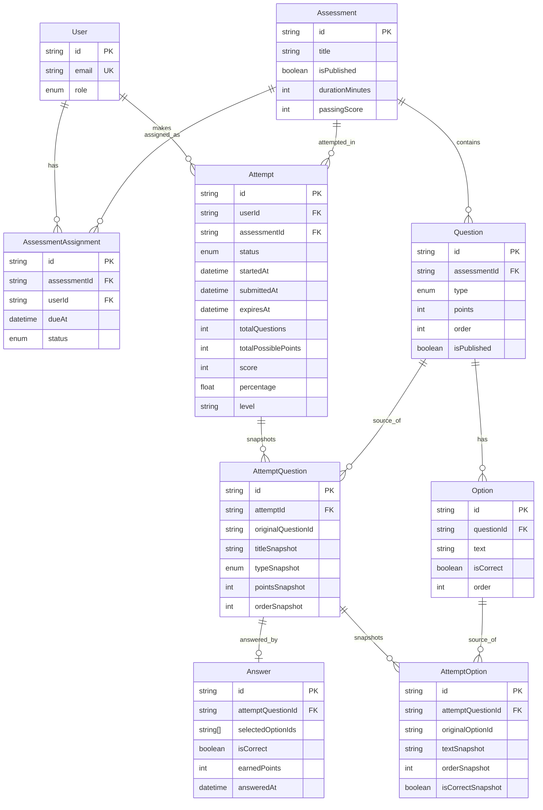
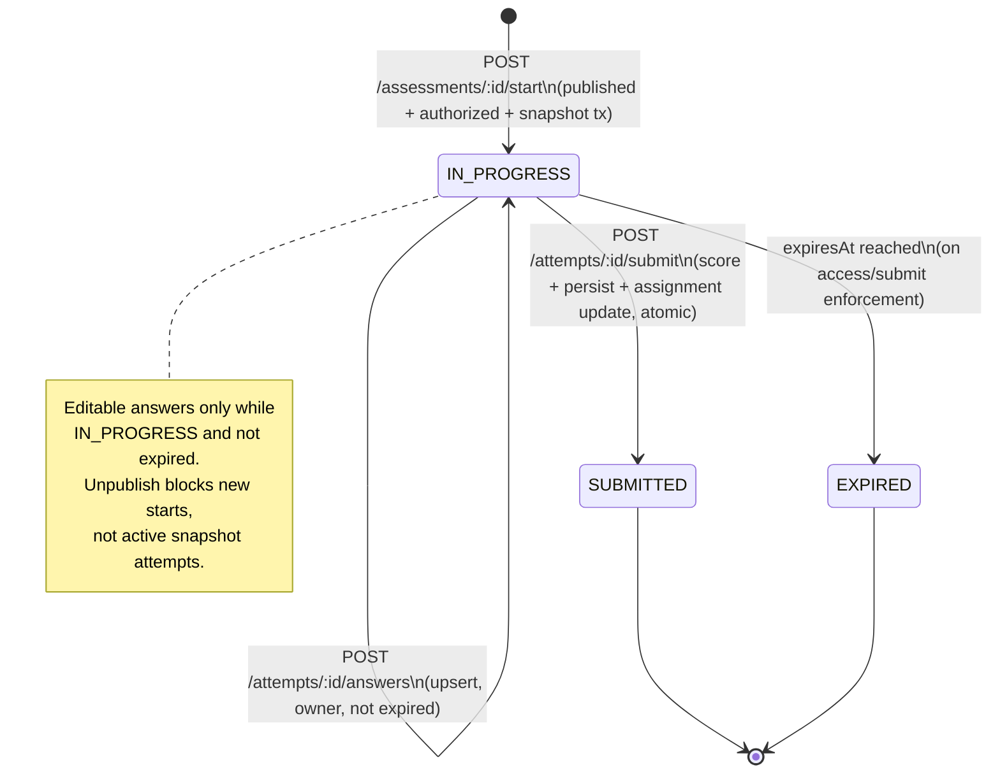
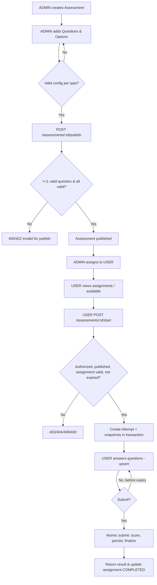
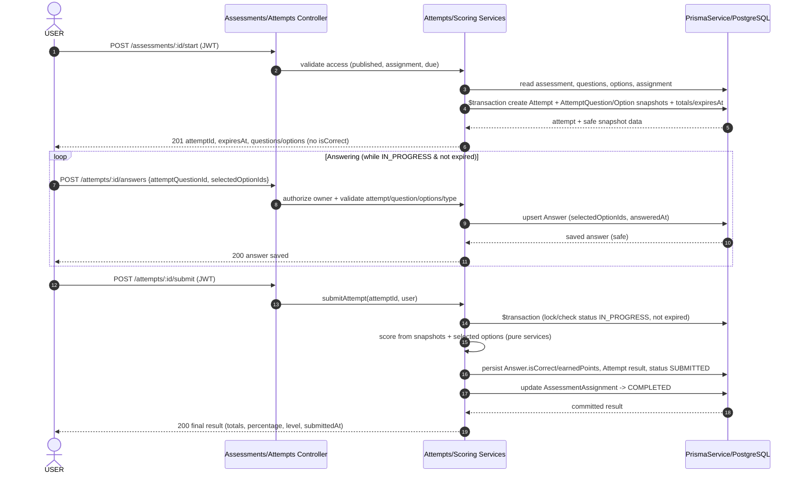

# Assessment System Design

## Actors

| Actor | Description | Authentication | Primary permissions |
|---|---|---|---|
| `USER` | Authenticated learner (existing `Role.USER`) | JWT bearer access token (`Authorization: Bearer <token>`), validated by `JwtAuthGuard`/`JwtStrategy`; identity from `@CurrentUser()` (`AuthenticatedUser`: `userId`, `email`, `role`, `sessionId`) | View own assignments and assessment history/results; start assigned published assessments; view own in-progress attempt questions (safe, no correct answers); save answers on own attempts; submit own attempts; view own results. Cannot create/publish/manage assessments/questions/options/assignments or access other users’ attempts/results. |
| `ADMIN` | Authenticated administrator (existing `Role.ADMIN`) | Same JWT auth; role enforced by `RolesGuard` + `@Roles(Role.ADMIN)` (existing RBAC pattern) | All `USER` capabilities for own data plus: create/update/delete/publish/unpublish assessments; manage questions/options; create/list/manage assignments; view attempts/results for any user or assessment (authorized admin scope); inspect assessment authoring data including correct-option configuration. |
| `SYSTEM` (internal) | Application runtime/services | N/A | Creates attempt snapshots in a transaction at start; enforces expiration/status transitions; calculates scores/levels via deterministic backend services; persists final results atomically; never trusts client correctness/score fields. |

**Authorization conventions (aligned with current project):** UUID path params validated with `ParseUUIDPipe`; resource ownership checked in services/controllers using JWT `userId` (never request-body `userId`); admin-only routes guarded with `JwtAuthGuard, RolesGuard` + `@Roles(Role.ADMIN)`; ownership violations → `403 Forbidden`, unauthenticated → `401 Unauthorized`. Global `ValidationPipe` (`whitelist`, `forbidNonWhitelisted`, `transform`) and centralized `AllExceptionsFilter` (`{statusCode,error,message,path,timestamp}`, 5xx masked) apply.

## Entities

> Implemented in Prisma (`prisma/schema.prisma`, PostgreSQL datasource, Prisma Client generated to `src/generated/prisma`) following existing conventions: string UUID ids (`@default(uuid())`), camelCase fields, `DateTime` timestamps, explicit relations, `@@unique`/`@@index`, cascade/restrict policies chosen for integrity and history preservation.

### Assessment
| Field | Type | Constraints / notes |
|---|---|---|
| `id` | `String @id @default(uuid())` | PK |
| `title` | `String` | required, non-empty (DTO) |
| `description` | `String?` | optional |
| `instructions` | `String?` | optional |
| `durationMinutes` | `Int?` | optional, `> 0` when set; drives `Attempt.expiresAt` |
| `passingScore` | `Int?` | optional percentage threshold 0–100 (informational/policy) |
| `isPublished` | `Boolean @default(false)` | only published assessments can be started by users |
| `createdAt` | `DateTime @default(now())` | |
| `updatedAt` | `DateTime @updatedAt` | |

**Relations:** 1:N `Question`, 1:N `Attempt`, 1:N `AssessmentAssignment`. **Indexes:** `isPublished`, `createdAt`.

### Question
| Field | Type | Constraints / notes |
|---|---|---|
| `id` | `String @id @default(uuid())` | PK |
| `assessmentId` | `String` | FK → `Assessment.id` |
| `title` | `String` | required |
| `description` | `String?` | optional |
| `type` | `QuestionType` enum | `SINGLE_CHOICE \| MULTIPLE_CHOICE \| TRUE_FALSE` |
| `points` | `Int` | `>= 0` (DTO/validation), typically `> 0` for scored questions |
| `order` | `Int @default(0)` | deterministic display/scoring order |
| `isPublished` | `Boolean @default(false)` | question readiness flag; assessment publish validates all included questions |
| `createdAt`, `updatedAt` | `DateTime` | |

**Relations:** N:1 `Assessment` (`onDelete: Cascade` for authoring cleanup when no historical dependency conflicts; edits restricted when published/in-use per rules), 1:N `Option`, 1:N `AttemptQuestion` (snapshot source, `originalQuestionId`). **Indexes:** `(assessmentId)`, `(assessmentId, order)`.

### Option
| Field | Type | Constraints / notes |
|---|---|---|
| `id` | `String @id @default(uuid())` | PK |
| `questionId` | `String` | FK → `Question.id` |
| `text` | `String` | required |
| `isCorrect` | `Boolean @default(false)` | **admin/authoring only; never exposed to regular users** |
| `order` | `Int @default(0)` | deterministic order |
| `createdAt`, `updatedAt` | `DateTime` | |

**Relations:** N:1 `Question` (`onDelete: Cascade`), 1:N `AttemptOption` (`originalOptionId`). **Indexes:** `(questionId)`, `(questionId, order)`.

### AssessmentAssignment
| Field | Type | Constraints / notes |
|---|---|---|
| `id` | `String @id @default(uuid())` | PK |
| `assessmentId` | `String` | FK → `Assessment.id` |
| `userId` | `String` | FK → `User.id` (existing model) |
| `assignedAt` | `DateTime @default(now())` | |
| `dueAt` | `DateTime?` | optional; must be >= `assignedAt`/now per validation |
| `status` | `AssignmentStatus` enum | `ASSIGNED \| COMPLETED \| EXPIRED` |
| `createdAt`, `updatedAt` | `DateTime` | |

**Relations:** N:1 `Assessment`, N:1 `User`. **Constraints/Indexes:** prevent duplicate *active* assignments for same user+assessment (e.g. unique composite on `(assessmentId, userId, status)` where practical in Prisma via `@@unique([assessmentId,userId,status])` combined with status transitions, and/or partial-unique enforced by application transaction + check; design target: at most one `ASSIGNED` record per `(userId, assessmentId)` enforced by DB constraint strategy compatible with Postgres/Prisma). Indexes `(userId)`, `(assessmentId)`, `(status)`, `(dueAt)`. History preserved (records not deleted on completion; status updated).

### Attempt
| Field | Type | Constraints / notes |
|---|---|---|
| `id` | `String @id @default(uuid())` | PK |
| `userId` | `String` | FK → `User.id` |
| `assessmentId` | `String` | FK → `Assessment.id` |
| `status` | `AttemptStatus` enum | `IN_PROGRESS \| SUBMITTED \| EXPIRED` |
| `startedAt` | `DateTime @default(now())` | |
| `submittedAt` | `DateTime?` | set on submit |
| `expiresAt` | `DateTime?` | `startedAt + durationMinutes` when duration set |
| `totalQuestions` | `Int` | snapshot count at start |
| `totalPossiblePoints` | `Int` | snapshot sum at start |
| `score` | `Int @default(0)` | earned points (finalized on submit) |
| `percentage` | `Float @default(0)` | finalized on submit (consistent rounding) |
| `level` | `String?` | finalized on submit via `LevelMappingService` |
| `createdAt`, `updatedAt` | `DateTime` | |

**Relations:** N:1 `User`, N:1 `Assessment`, 1:N `AttemptQuestion` (`onDelete: Cascade` from attempt to its snapshots/answers for owned attempt data), optional link to triggering assignment handled by business logic/status sync. **Indexes:** `(userId)`, `(assessmentId)`, `(status)`, `(userId, assessmentId)`, `(submittedAt)`.

### AttemptQuestion (snapshot)
| Field | Type | Constraints / notes |
|---|---|---|
| `id` | `String @id @default(uuid())` | PK |
| `attemptId` | `String` | FK → `Attempt.id` |
| `originalQuestionId` | `String` | reference to source `Question.id` (no FK restriction required that would block source edits/deletes affecting history; integrity via snapshot data) |
| `titleSnapshot` | `String` | copied at attempt start |
| `typeSnapshot` | `QuestionType` | copied at attempt start |
| `pointsSnapshot` | `Int` | copied at attempt start |
| `orderSnapshot` | `Int` | deterministic |

**Relations:** N:1 `Attempt` (`onDelete: Cascade`), 1:N `AttemptOption`, 1:1 (at most) `Answer`. **Indexes:** `(attemptId)`, `(attemptId, orderSnapshot)`, `(originalQuestionId)`. **Unique:** `@@unique([attemptId, originalQuestionId])` to prevent duplicate snapshot rows per attempt.

### AttemptOption (snapshot)
| Field | Type | Constraints / notes |
|---|---|---|
| `id` | `String @id @default(uuid())` | PK |
| `attemptQuestionId` | `String` | FK → `AttemptQuestion.id` |
| `originalOptionId` | `String` | source option reference |
| `textSnapshot` | `String` | copied at start |
| `orderSnapshot` | `Int` | deterministic |
| `isCorrectSnapshot` | `Boolean` | **stored for scoring only; NEVER returned in user-facing responses** |

**Relations:** N:1 `AttemptQuestion` (`onDelete: Cascade`). **Indexes:** `(attemptQuestionId)`, `(originalOptionId)`. **Unique:** `@@unique([attemptQuestionId, originalOptionId])`.

### Answer
| Field | Type | Constraints / notes |
|---|---|---|
| `id` | `String @id @default(uuid())` | PK |
| `attemptQuestionId` | `String` | FK → `AttemptQuestion.id` |
| `selectedOptionIds` | `String[]` | Postgres text array of **AttemptOption snapshot ids** selected for this question (adapted to Prisma/Postgres conventions) |
| `isCorrect` | `Boolean @default(false)` | computed/persisted by backend on submit (and/or recalculated) |
| `earnedPoints` | `Int @default(0)` | computed/persisted by backend on submit |
| `answeredAt` | `DateTime?` | last saved time |
| `createdAt`, `updatedAt` | `DateTime` | |

**Relations:** N:1 `AttemptQuestion` (`onDelete: Cascade`). **Constraints:** `@@unique([attemptQuestionId])` (at most one answer per attempt question; upsert). **Validation rules (service):** all selected ids exist and belong to the same `AttemptQuestion`; no duplicates; cardinality/type rules enforced per `typeSnapshot`. **No client-provided `isCorrect`/`earnedPoints` accepted.**

### Prisma enums (additions)
- `QuestionType`: `SINGLE_CHOICE`, `MULTIPLE_CHOICE`, `TRUE_FALSE`
- `AttemptStatus`: `IN_PROGRESS`, `SUBMITTED`, `EXPIRED`
- `AssignmentStatus`: `ASSIGNED`, `COMPLETED`, `EXPIRED`

### Entity Relationship Diagram (ERD)

## Rules

### Actors & authorization
- **Create/update/delete/publish/unpublish assessments, questions, options, assignments:** `ADMIN` only.
- **Start attempt, save answers, submit, view own attempts/results/history/assignments:** authenticated `USER` (owner) or `ADMIN` acting on own data where applicable; cross-user access denied (`403`) unless admin-specific endpoint.
- **View admin history/results:** `ADMIN` only (`GET /assessments/:id/attempts`, `GET /users/:id/assessments`).

### Assessment/question/option authoring & publishing
- Assessment must have `title`; DTO validation enforced. Question must reference existing assessment; option must reference existing question.
- Supported types: `SINGLE_CHOICE`, `MULTIPLE_CHOICE`, `TRUE_FALSE`.
- **SINGLE_CHOICE:** exactly 1 option with `isCorrect=true` (and >=2 options recommended/validated as configured; at minimum exactly one correct).
- **TRUE_FALSE:** exactly 2 options total and exactly 1 correct.
- **MULTIPLE_CHOICE:** >=2 options and >=1 correct.
- Invalid configurations cannot be published: `POST /assessments/:id/publish` validates assessment has >=1 valid, publishable question and every question has a valid option configuration; otherwise `400/422` with clear validation errors. Publishing questions individually also validates their option set.
- Editing/deleting: do not allow changes that compromise historical integrity of existing attempts. Snapshots are immutable records of taken attempts; authoring changes affect only future attempts. Published assessment structural edits that invalidate integrity are restricted (e.g. require unpublish/draft workflow) per implementation policy; correctness is never retroactively applied to submitted snapshots except source-of-truth for future attempts.
- Correct answers (`Option.isCorrect`, `AttemptOption.isCorrectSnapshot`, answer correctness internals) are **never exposed to regular users** and never in ordinary user-facing history APIs.

### Starting assessments & assignment access
- Start requires: assessment exists (`404`), assessment `isPublished=true` (`409/400` not-published), authenticated user authorized.
- **Assignment policy (defined):** users may start an assessment only when they have an `AssessmentAssignment` for `(userId, assessmentId)` with `status=ASSIGNED` and not past `dueAt` (if set). `ADMIN` may start for testing/operations if explicitly allowed by endpoint policy (default: same rules, or admin override documented in implementation) — primary enforced rule: prevent users from starting assessments they are not authorized to access. Unrestricted public access is **not** granted unless an explicit future policy flag is added; assignment is the access control mechanism.
- **Multiple attempts:** allowed (a user may start the same assessment multiple times) creating a new `Attempt` each time; each attempt has independent snapshots, answers, timing, and result. (If business later restricts, enforce via assignment/attempt-count rule; current rule: multiple attempts supported.)
- **Unpublish during active attempt:** starting new attempts is blocked once unpublished; existing `IN_PROGRESS` (or already `SUBMITTED`) attempts remain valid and can be completed/submitted based on snapshot data and their own status/expiry rules.
- Expiration: if `durationMinutes` set, `expiresAt = startedAt + durationMinutes`. An `IN_PROGRESS` attempt past `expiresAt` is treated as `EXPIRED` (status transitioned on read/submit attempt or enforced consistently) and cannot accept answer saves or normal submission; policy returns `409 Conflict` (or `400`) indicating expired attempt.

### Attempt/answer modification & submission
- Users cannot modify answers after attempt `SUBMITTED` or `EXPIRED` (`409`).
- Before submission (and before expiry) users may save/change answers; answer persistence uses **upsert** on `(attemptQuestionId)` to prevent duplicates.
- Attempt questions/options in save/submit must belong to the specified attempt and that attempt must belong to the authenticated user (`403`/`404`).
- All `selectedOptionIds` must be valid `AttemptOption` ids belonging to that `AttemptQuestion`, non-duplicated, and type-compatible: `SINGLE_CHOICE`/`TRUE_FALSE` require exactly 1 selection; `MULTIPLE_CHOICE` requires >=1 valid selection.
- Client-provided scores/correctness (`isCorrect`, `earnedPoints`, totals/level) are ignored/rejected by DTO whitelist; backend computes all results.

### Scoring & levels
- **Deterministic, pure scoring** in a dedicated service (independent of controllers/DB): `calculateQuestionScore(questionType, selectedOptionIds, correctOptionIds, points)` with exact set comparison (order-insensitive) for `MULTIPLE_CHOICE`.
  - `SINGLE_CHOICE`: full `points` if selected set equals correct single id, else `0`.
  - `TRUE_FALSE`: full `points` if selected equals correct single id, else `0`.
  - `MULTIPLE_CHOICE`: full `points` only if selected set exactly matches correct set, else `0`.
- Unanswered question = `0` earned points. `earnedPoints` total = sum over snapshot questions. `totalPossiblePoints` from attempt snapshot.
- `percentage = totalPossiblePoints === 0 ? 0 : (earnedPoints / totalPossiblePoints) * 100`, rounded consistently (e.g. 2 decimal places, fixed rule) with careful floating-point handling.
- **Level mapping** in a dedicated service/config (single function), default thresholds:
  - `BEGINNER`: 0–49
  - `INTERMEDIATE`: 50–74
  - `ADVANCED`: 75–89
  - `EXPERT`: 90–100
  Boundary-inclusive and unit-tested at every threshold.

### Transactions, concurrency & integrity
- **Start attempt:** create `Attempt` + `AttemptQuestion` + `AttemptOption` snapshots and totals in a single `prisma.$transaction` to avoid incomplete attempts.
- **Submit attempt:** verify ownership/status/expiry, compute scores from snapshots/answers, persist answer correctness/earned points, persist attempt result fields, set `SUBMITTED` + `submittedAt`, and update related `AssessmentAssignment` to `COMPLETED` **atomically** in one transaction.
- **Duplicate submission / concurrency:** guarded by transactional status precondition (submit only when `IN_PROGRESS`) and conditional/atomic update (e.g. `updateMany` where `id` and `status=IN_PROGRESS` expecting count=1) so the same attempt cannot produce multiple final results; concurrent requests yield one success and others `409 Conflict`.
- **Assignments:** prevent duplicate active assignment for same user+assessment via DB constraint + conflict handling (`409`); `dueAt` validated; assignment status updated on submit and preserved historically.

### Attempt lifecycle diagram

### Assessment flow diagram

### Sequence diagram (start to final result)

## API

> Conventions: REST + JSON, existing global validation/exception filter, JWT auth (`JwtAuthGuard`), RBAC (`RolesGuard`/`@Roles`), pagination meta `{total,page,limit,totalPages,hasNextPage,hasPreviousPage}`, deterministic ordering. **User-facing attempt/answer/result/history endpoints never expose `isCorrect`, `isCorrectSnapshot`, or correct option identifiers except where an explicit admin/authoring context requires it.**

### Assessment management (ADMIN)
| Method | Endpoint | Auth | Description | Request (DTO/body/query) | Response (200/201) | Errors |
|---|---|---|---|---|---|---|
| POST | `/assessments` | ADMIN | Create assessment (draft/unpublished by default) | body: `{title, description?, instructions?, durationMinutes?, passingScore?, isPublished?=false}` | 201 Assessment | 400/422 validation |
| GET | `/assessments` | ADMIN | List assessments (pagination/filter/sort) | query: `page,limit,search,sortBy,sortOrder,isPublished` | 200 `{data:[Assessment], meta}` | 400 invalid query |
| GET | `/assessments/:id` | ADMIN | Get assessment details (+ questions/options for authoring) | param `id` UUID | 200 Assessment detail | 404 |
| PATCH | `/assessments/:id` | ADMIN | Update assessment (restricted if would compromise existing attempts/published integrity) | body partial fields | 200 Assessment | 400/404/409 |
| DELETE | `/assessments/:id` | ADMIN | Delete assessment (policy: restricted if attempts/history exist; else cascade authoring data) | param `id` | 200 `{deleted:true}` or 204 | 404/409 |
| POST | `/assessments/:id/publish` | ADMIN | Publish if valid | — | 200 Assessment | 400/422 invalid config, 404 |
| POST | `/assessments/:id/unpublish` | ADMIN | Unpublish (blocks new starts) | — | 200 Assessment | 404 |

### Question management (ADMIN)
| Method | Endpoint | Auth | Request | Response | Errors |
|---|---|---|---|---|---|
| POST | `/assessments/:id/questions` | ADMIN | `{title, description?, type, points, order?, isPublished?}` | 201 Question | 400/404 |
| GET | `/assessments/:id/questions` | ADMIN | query `page,limit,sortBy,sortOrder` | 200 `{data,meta}` or ordered list (paginated) | 404 |
| PATCH | `/questions/:id` | ADMIN | partial question fields (type/structure edits validated) | 200 Question | 400/404/409 |
| DELETE | `/questions/:id` | ADMIN | — | 200/204 | 404/409 |

### Option management (ADMIN)
| Method | Endpoint | Auth | Request | Response | Errors |
|---|---|---|---|---|---|
| POST | `/questions/:id/options` | ADMIN | `{text, isCorrect, order?}` | 201 Option (admin view) | 400/404 |
| PATCH | `/options/:id` | ADMIN | `{text?, isCorrect?, order?}` | 200 Option | 400/404/409 |
| DELETE | `/options/:id` | ADMIN | — | 200/204 | 404/409 |

### Assessment assignment (ADMIN create/manage, USER read own)
| Method | Endpoint | Auth | Request | Response | Errors |
|---|---|---|---|---|---|
| POST | `/assessments/:id/assignments` (or `/assignments`) | ADMIN | `{userId, dueAt?}` (assessmentId from path/body) | 201 Assignment | 400/404/409 duplicate active |
| GET | `/assignments/me` | USER | query pagination/filter (`status,assessmentId`) | 200 `{data,meta}` | 401 |
| GET | `/assignments` | ADMIN | query pagination/filter (`userId,assessmentId,status`) | 200 `{data,meta}` | 403 |
| GET | `/assignments/:id` | USER/ADMIN | — | 200 Assignment (owner or admin) | 403/404 |
| PATCH | `/assignments/:id` (optional admin manage/cancel/expire) | ADMIN | `{status?, dueAt?}` | 200 Assignment | 400/404/409 |

### Attempt lifecycle & answers (USER owner; admin access only via admin history endpoints)
| Method | Endpoint | Auth | Request | Response | Errors |
|---|---|---|---|---|---|
| POST | `/assessments/:id/start` | USER (JWT) | — | 201 `{attempt:{id,status,startedAt,expiresAt,totalQuestions,totalPossiblePoints}, questions:[{attemptQuestionId,title,type,points,order, options:[{attemptOptionId,text,order}]}]}` **no correct answers** | 401/403/404/409 not published/not assigned/duplicate-invalid state |
| GET | `/attempts/:id/questions` | USER owner | — | 200 safe questions/options for attempt (ordered) | 401/403/404/409 expired/submitted rules as applicable |
| POST | `/attempts/:id/answers` | USER owner | `{attemptQuestionId, selectedOptionIds:["option-id",...]}` | 200 `{attemptQuestionId, selectedOptionIds, answeredAt}` (safe) | 400 invalid options/type/duplicates, 401/403/404, 409 not IN_PROGRESS/expired/submitted |
| POST | `/attempts/:id/submit` | USER owner | — | 200 final result (see below) | 401/403/404/409 already submitted/expired/invalid |
| GET | `/attempts/:id/result` | USER owner or ADMIN (authorized) | — | 200 result payload | 401/403/404/409 not submitted yet (if applicable) |

### History & results
| Method | Endpoint | Auth | Request | Response | Errors |
|---|---|---|---|---|---|
| GET | `/users/me/assessments` | USER | query `page,limit,assessmentId,status,from,to,level,sortBy,sortOrder` | 200 `{data:[attempt/history summary + result fields], meta}` | 401/400 |
| GET | `/assessments/:id/attempts` | ADMIN | query pagination/filters (`userId,status,from,to,level`) | 200 `{data,meta}` | 403/404 |
| GET | `/users/:id/assessments` | ADMIN | query pagination/filters (`assessmentId,status,from,to,level`) | 200 `{data,meta}` | 403/404 |

**Standard result payload (submit/result/history item):** `{attemptId, assessmentId, userId?, status, totalQuestions, answeredQuestions, correctAnswers, incorrectAnswers, unansweredQuestions, earnedPoints, totalPossiblePoints, percentage, level, submittedAt}`. No correct option data included.

## Edge Cases

| Scenario | Expected HTTP | Notes / behavior |
|---|---|---|
| Missing/invalid/expired JWT | 401 Unauthorized | `JwtAuthGuard`/strategy; consistent error body |
| Authenticated but insufficient role | 403 Forbidden | `RolesGuard` on admin endpoints |
| Accessing another user’s attempt/assignment/result/history | 403 Forbidden | Ownership check against JWT `userId` |
| Resource not found (assessment/question/option/attempt/assignment/user) | 404 Not Found | |
| DTO/query/body validation failure, malformed UUID | 400 Bad Request | ValidationPipe + ParseUUIDPipe |
| Duplicate active assignment (same user+assessment) | 409 Conflict | DB unique constraint + handled conflict |
| Start unpublished assessment | 409 Conflict (or 400) | “Assessment is not published” |
| Start without required/valid assignment or unauthorized access | 403 Forbidden | Assignment policy enforced |
| Start when assignment past `dueAt` / assignment expired | 409 Conflict (or 403 per policy) | Clear message; assignment may be marked EXPIRED |
| Unpublish during active attempt | 200 for existing attempt ops; new starts blocked 409 | Snapshots preserve attempt |
| Answer save after submission | 409 Conflict | Attempt not IN_PROGRESS |
| Answer save/submit after `expiresAt` | 409 Conflict | Attempt marked/treated EXPIRED; not editable/submittable as active |
| `attemptQuestionId` not in attempt or attempt not owned | 403/404 | No info leakage across users |
| `selectedOptionIds` invalid/duplicate/not belonging to attempt question | 400 Bad Request | Validation error |
| Wrong selection cardinality for type (e.g. multiple for SINGLE_CHOICE) | 400/422 | Type rules enforced |
| Duplicate answer rows | Prevented | `@@unique([attemptQuestionId])` + upsert |
| Duplicate/concurrent submit | 409 Conflict for losing concurrent request | Atomic status-conditional transaction; single final result |
| Publish assessment with no questions or invalid question/option config | 400/422 | Publishing validation |
| Invalid question config (SINGLE_CHOICE not exactly 1 correct; TRUE_FALSE not 2 options/1 correct; MULTIPLE_CHOICE no correct option) | 400/422 | On create/update/publish as applicable |
| Zero questions / zero possible points | 200 with defined result | `percentage=0`, level mapped from 0 by single mapping function |
| Missing answers at submit | Scored as 0 for those questions | Included in unanswered count |
| Client sends `isCorrect`/`earnedPoints`/score fields | 400/ignored | DTO whitelist/forbidNonWhitelisted; backend authoritative |
| Admin structural edits that compromise existing attempts | 409/400 restricted | Snapshot/history integrity protected |
